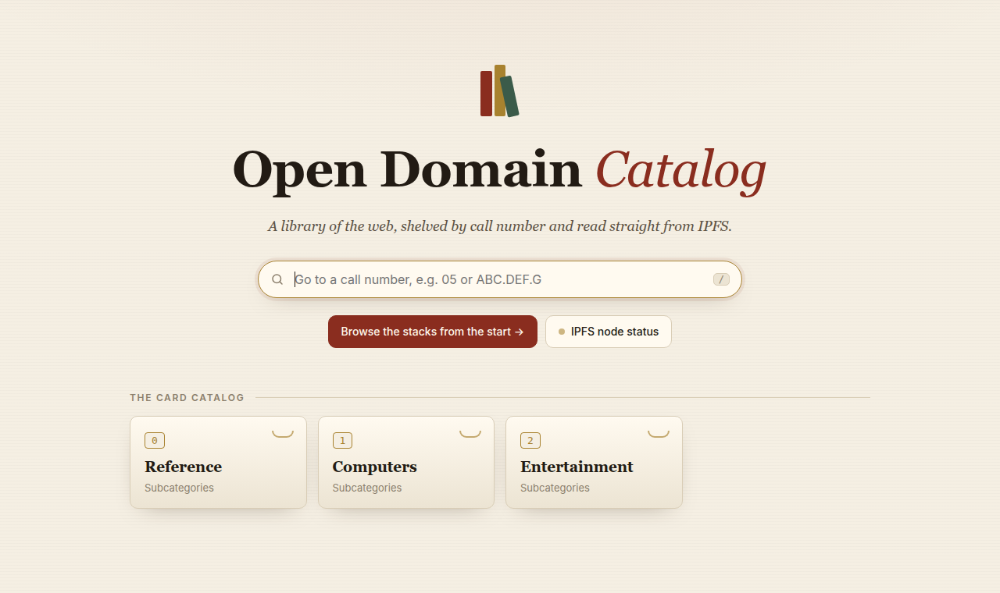
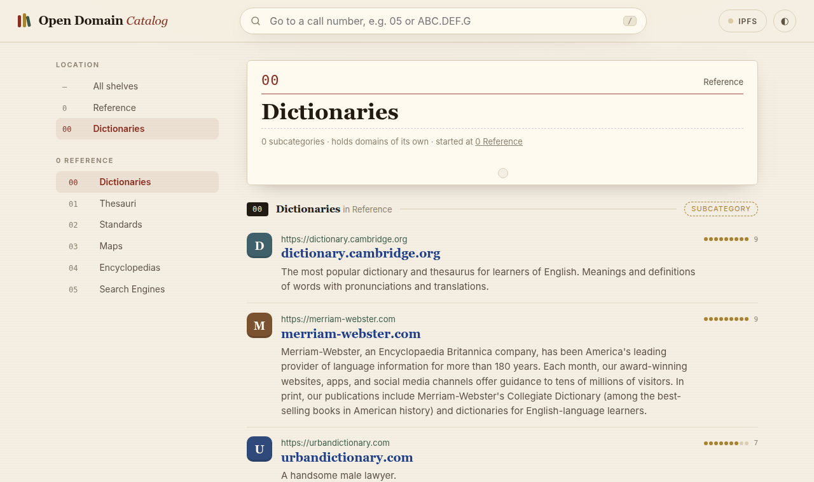
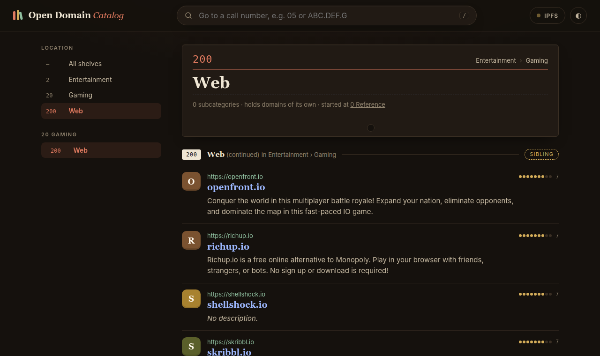

<div align="center">


# ODC Explorer

**A library for the web, read straight from IPFS.**

Browse the [Open Domain Catalog](odc-chain-spec.md) shelf by shelf, with no gateways,
no trackers and no third-party requests. Every reader helps keep the catalog online.

[Features](#features) · [Install](#getting-started) · [Usage](#usage) · [How it works](#how-it-works) · [Privacy](#privacy) · [Development](#development)



</div>

---

## What is this?

The **Open Domain Catalog (ODC)** is a directory of websites organised like a
library. Every domain sits under a call number, such as `05` for *Reference ›
Search Engines*, and is ranked by cultural relevance and author authority. The
whole catalog is stored as content-addressed blocks on IPFS and published under a
single IPNS name. It's defined in [`odc-chain-spec.md`](odc-chain-spec.md).

**ODC Explorer** is a client for it. It runs on your machine as a small web app
backed by its own embedded IPFS peer, [pyipfs](pyipfs/README.md), so you read the
catalog directly from the peer-to-peer network rather than through someone's
server.

## Features

- 📚 **Browse like a library.** Start at any category and read 25 domains at a time.
  Pages dive into its subcategories, then move on to the next sibling categories,
  all the way to the end of the catalog. The header and sidebar follow along,
  showing the subject you're on and the shelf it sits on.
- 🔞 **Hide adult content.** One switch hides call number `0` and everything
  under it, remembered in your browser.
- 🔢 **Jump to any call number.** Type `05`, `ABC.DEF.G` or `abcdefg` to go
  straight there.
- 🌐 **Real IPFS, built in.** No daemon to install and no HTTP gateways. The
  explorer resolves the catalog's IPNS name and fetches blocks over Bitswap and the
  DHT itself, always reading the latest published version.
- 🤝 **Shares what it reads.** Every reader serves the blocks it has fetched, and
  pyipfs announces them on the DHT, so the catalog stays available even when
  ODC's own nodes don't.
- ✅ **Checks everything.** Every block is validated against the spec. Broken
  blocks are skipped with a warning instead of breaking the page.
- 🔒 **Private by design.** The page loads nothing from other sites: no fonts, no
  CDNs, no analytics, and a strict Content Security Policy.
- 📡 **IPFS status page.** A live view of peers, addresses, NAT traversal, DHT,
  Bitswap, storage and block sharing.
- 🌗 **Light and dark themes**, and a layout that works on phones.
- 🐧 **Installs per user on Linux** with an app-menu launcher, no `sudo` required.

<p align="center">
  
  
</p>

## Getting started

### Requirements

- Linux
- Python 3.9 or newer
- Flask (the installer takes care of it)

pyipfs is bundled in this repository and has no dependencies of its own.

### Install (recommended)

From a clone of this repository:

```sh
./install.sh
```

Then open **ODC Explorer** from your applications menu (under *Network*), or run:

```sh
odc-explorer-launch
```

The installer is per user. It needs no `sudo` and writes nothing outside your home
folder. It copies the app out of the clone, sets up a private Python environment
for Flask (or uses your distro's `python3-flask` if it's installed), and adds the
launcher, icon and commands. After installing, you can move or delete the clone.

<details>
<summary>What gets installed where</summary>

| What | Where |
|---|---|
| App and bundled pyipfs | `~/.local/share/odc-explorer/app/` |
| Private Python environment | `~/.local/share/odc-explorer/venv/` |
| App-menu launcher, with icon | `~/.local/share/applications/odc-explorer.desktop` |
| Icon (16–512 px PNG + SVG) | `~/.local/share/icons/hicolor/*/apps/odc-explorer.*` |
| `odc-explorer-launch`: start or open / stop / restart / status / log | `~/.local/bin/` |
| `odc-explorer`: run the server in a terminal | `~/.local/bin/` |
| Launcher settings | `~/.config/odc-explorer/config` |
| Server log and pid file | `~/.local/state/odc-explorer/` |
| Your data: block cache, node identity | `~/.odc-explorer/` |

</details>

To **update**, pull the latest changes and run `./install.sh` again. It stops a
running server first and keeps your settings and data.

To **uninstall**:

```sh
./install.sh --uninstall   # remove the app, launcher and icons; keep your data
./install.sh --purge       # remove everything, including the block cache
```

### Run from source

If you'd rather not install anything:

```sh
python3 -m pip install -r requirements.txt
./run.sh --open
```

`--open` opens your browser. Otherwise go to <http://127.0.0.1:8181/>. Stop the
server with <kbd>Ctrl</kbd>+<kbd>C</kbd>.

You can also run `python3 -m odc_explorer` from the repository root. Neither
package is installed, so it needs to run from there, or with the root on
`PYTHONPATH`.

> [!NOTE]
> The first page can take **20–30 seconds** while the node joins the IPFS network
> and resolves the catalog. After that, blocks come from the local cache, including
> after restarts.

### Configuration

| Option | Default | Description |
|---|---|---|
| `--port` | `8181` | Web UI port |
| `--host` | `127.0.0.1` | Interface for the web UI. Use `0.0.0.0` to allow other machines on your network |
| `--repo` | `~/.odc-explorer` | Block cache, node identity, last known root, and pyipfs's announcement progress |
| `--open` | off | Open the explorer in your browser |
| `--debug` | off | Verbose logging |

The web port is checked before anything starts. If it's taken, you get a clear
error naming the port. The IPFS node picks its own port each time it starts; the
IPFS status page shows which one.

When you use the app-menu launcher, set `PORT` and `EXTRA_ARGS` in
`~/.config/odc-explorer/config`.

## Usage

### Browsing

The home page shows the top-level categories as card-catalog drawers. Open one, or
choose **Browse the stacks from the start** to read the whole catalog in order.

Domains appear **25 at a time**, moving forward from the category you chose:

1. The category's own domains, by rank (9 → 0), then by name
2. Its subcategories, in key order (`0`–`9`, then `A`–`Z`), diving into each one
   until they're all exhausted
3. Then the next sibling category, with its subcategories, and the siblings after
   that
4. When there are no more siblings, the parent's next sibling, and so on

Reading **stops at the end of the catalog**. It never goes back to categories
before the one you chose. For example, starting at `05` you get `05` and its
subcategories, then `06`, `07` … `0Z`, then `1`, `2` … up to the last category
in the catalog. `00` … `04` and `0`'s own domains aren't shown, because they come
before `05`. Starting from *All shelves* reads the whole catalog.

If a category has fewer than 25 domains, the page carries on into the next ones.
Each new category gets a header marked **Subcategory**, **Sibling** or **Next on
the shelf**. **Next 25** picks up exactly where you left off. Every page is read
from the latest published version of the catalog. Pages never change on their
own: to see a newly published version, navigate, reload, or click the link to the
page you're on. The last page is marked **End of the catalog**.

The **header** and the **sidebar** follow the subject of each page: the category
its first domain belongs to. The sidebar shows where that is (*Location*) and the
shelf it sits on, meaning the categories alongside it, with the current one
highlighted and its own subcategories nested underneath. When **Next 25** carries
you into a new subject, both change with it. The header also links back to where
you started reading.

Keyboard: <kbd>/</kbd> focuses the call-number box, and <kbd>←</kbd> /
<kbd>→</kbd> go to the previous or next page.

### Hiding adult content

The **18+** switch in the top bar, also on the home page, hides call number `0`
(*Adult*) and everything under it. The home drawers, sidebars and pages skip that
branch entirely, and pages still hold 25 domains each. Opening something inside
`0` while it's hidden shows a notice with a button to show it. The setting is
stored in your browser, so it applies per browser rather than per server.

### Going to a call number

Type a call number into the box at the top: `05`, `ABC.DEF.G` or `abcdefg`. Dotted
and bare forms both work, in any case. The box only takes call numbers; there's no
full-text search.

### The IPFS status page

The **IPFS** button in the top bar opens a live view of the embedded node,
refreshed every 5 seconds:

| Section | Shows |
|---|---|
| Node | Peer ID, versions, key type, crypto backend, uptime, protocols served |
| Catalog root | IPNS name, current root and its sequence number, previous root, when it was last resolved |
| Addresses | Announced, public, listening, observed, router-mapped and relay addresses, plus AutoNAT verdicts |
| NAT traversal | UPnP / NAT-PMP mappings, AutoNAT results, relay reservations, hole punching |
| DHT and Bitswap | Routing table size, blocks and bytes sent and received, blocks peers want |
| Repository | Storage use against the 2 GB cache limit, eviction counters, and the in-memory block cache (size, hit rate) |
| Block sharing | pyipfs's provider: strategy, progress, last pass, failures, and every shared block with when it was last announced and is next due |
| Peers | A filterable table of current connections |

The dot on the button is 🟢 when the node is directly reachable, 🟡 when it's
reachable through a relay, and 🔴 when it has no peers.

### The app-menu launcher

Clicking **ODC Explorer** starts the server in the background if it isn't
running, then opens your browser. Clicking again reuses the same server. The
server keeps running, and keeps sharing blocks, after you close the browser.

Right-click the launcher for **Stop ODC Explorer** and **Show Server Log**, or use
the command line:

```sh
odc-explorer-launch [start|open|stop|restart|status|log]
```

If the server can't start, for example because a port is taken, you get a desktop
notification saying why.

## How it works

```
IPNS name ──resolve──▶ root inode ──▶ inode ──▶ … ──▶ inode
 (every minute)          (layer 1)     (2)            (≤ 9)
                            │            │               │
                          cards        cards           cards ──▶ card ──▶ card ──▶ …
                                                                (25 domains each)
```

1. **Resolve the root.** ODC publishes the catalog's current root under the IPNS
   name `k51qzi5uqu5dlw1jsigau9m0tfqupv2zhyr2bwkfvycsq38oqqzr35mk6eq3mg`. It's set
   as `ODC_IPNS_NAME` in [`service.py`](odc_explorer/service.py). The explorer
   resolves it at startup and every minute. Right after a publication some DHT
   nodes still hold older records, so it collects up to 16 and takes the one with
   the highest sequence number. It never goes back to an older sequence than it
   has already seen. It remembers the last root and its sequence, so it can serve
   pages before the first lookup finishes.
2. **Fetch only what's needed.** Inode and card blocks are fetched when a page needs
   them. pyipfs keeps them on disk (up to 2 GB) and its garbage collector evicts
   the least recently used. The explorer also keeps up to 64 MB of recently read
   blocks in memory, parsed and keyed by CID. Blocks are content-addressed, so a
   cached block never goes stale, and blocks that don't change between catalog
   versions stay cached when ODC publishes a new root.
3. **Validate.** Every block is checked against sections 4–5 of the spec:
   - type, call and card index match where the block was reached
   - field types and lengths are valid
   - blocks are at most 256 KiB
   - every card but the last holds exactly 25 domains
   - domains are in rank order across the whole card chain

   A malformed subtree is skipped and reported, and the rest of the page still
   works.

### Sharing blocks with other readers

Every running explorer is a full IPFS peer:

- It listens on a port pyipfs chooses, maps that port on your router (UPnP / NAT-PMP),
  checks its reachability with AutoNAT, and falls back to circuit relays and hole
  punching when it's behind a NAT.
- It serves every block in its cache over Bitswap.
- Announcing is handled by pyipfs's built-in provider. It announces every
  block in the cache on the DHT (strategy `all`), 8 at a time, once the node has
  a public or relay address. The explorer nudges it after each new block is
  fetched. It re-announces every 22 hours, retries failures with backoff, and
  forgets blocks that have been evicted from the cache. Its progress is kept in
  the repo (`ipfs/provider.sqlite`), so a restart only announces what's due.

> [!TIP]
> If your router doesn't support UPnP or NAT-PMP, or a firewall blocks inbound
> connections, the explorer still works. Other readers reach you through a relay
> instead, and hole punching upgrades those links to direct ones where it can.

## Privacy

- **No third-party web requests.** There are no HTTP gateways, CDNs, web fonts or
  analytics. The page uses your system fonts.
- **Locked-down page.** Every response sends
  `Content-Security-Policy: default-src 'self'` and `Referrer-Policy: no-referrer`,
  so the page can't load anything from elsewhere. Links to cataloged sites open
  only when you click them, and send no referrer.

> [!IMPORTANT]
> **What the IPFS network can see.** Taking part in IPFS means other peers can see
> your IP address and which blocks you ask for. Because the explorer shares blocks,
> your node is also listed publicly on the DHT as a provider of ODC catalog blocks.

## Development

### Project layout

```
├── install.sh             per-user Linux installer (launcher, icon, commands)
├── run.sh                 run from source
├── requirements.txt       Flask
├── odc-chain-spec.md      the ODC chain specification
├── odc_explorer/
│   ├── __main__.py        command line entry point (python -m odc_explorer)
│   ├── app.py             Flask app: routes, JSON API, security headers
│   ├── chain.py           ODC reader: call numbers, validation, reading order and paging
│   ├── service.py         IPFS node setup, IPNS refresh
│   ├── ipfs_status.py     node snapshot for the status page
│   ├── platform_compat.py default data folder, web port check
│   ├── templates/         index.html
│   └── static/            app.js, app.css, favicon.ico, icons/ (SVG + 16–512 px PNGs)
├── pyipfs/                pure-Python IPFS implementation (see pyipfs/README.md)
├── docs/screenshots/
└── tests/                 pyipfs test suite
```

### HTTP API

The front end is a single page that talks to a small JSON API:

| Endpoint | Returns |
|---|---|
| `GET /api/category?call=<call>` | A category's description, breadcrumbs and subcategories. An empty `call` returns the top level |
| `GET /api/flow?from=<call>&call=<call>&offset=<n>` | 25 domains in reading order, plus the cursor for the next page. `from` is where reading started (it defaults to `call`; empty means the whole catalog). `call` + `offset` is the position within it. Reading ends at the last category of the catalog |
| `GET /api/ipfs` | Everything shown on the IPFS status page |

`/api/category` and `/api/flow` also take `hide=<call>[,<call>…]`, which leaves those
branches out (the 18+ switch sends `hide=0`). Requesting a category inside a hidden
branch returns `403` with `"error": "hidden"`.

Every request is answered from the latest catalog root the explorer has resolved;
responses include it as `root`.

Errors are JSON `{"error", "message"}`:

- `404`: unknown call number
- `502`: malformed block
- `503`: catalog root not resolved yet

### Running the tests

```sh
python3 -m unittest discover -s tests -v
```

`tests/` holds the pyipfs test suite: offline tests, addressing, relays, storage
limits, crypto backends and the DHT provider. `test_kubo_interop.py` runs against
a local Kubo node and skips itself when none is reachable. See
[`pyipfs/README.md`](pyipfs/README.md) for details.

## Related

- [`odc-chain-spec.md`](odc-chain-spec.md): the Open Domain Catalog chain
  specification. It covers block formats, call numbers, ordering and publication.
- [`pyipfs/README.md`](pyipfs/README.md): the embedded IPFS implementation and its
  API.
